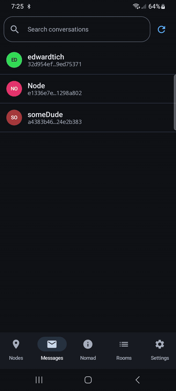

# Reticulum Mobile App

*Off-grid encrypted messaging for Android & iOS, over LoRa radio or the open internet. No servers, no accounts, no app-store lock-in.*

## Quick start

### 1. Install

**Android:** download `Reticulum-Android-<version>-release.apk` from the [latest release](https://github.com/thatSFguy/reticulum-mobile-app/releases/latest), open it, and allow the install. For automatic updates, [use Obtainium](docs/TECHNICAL.md#install-via-obtainium-recommended-for-ongoing-updates).

**iOS:** the app is sideloaded with a free Apple ID.

1. Install [AltStore](https://altstore.io/) or [SideStore](https://sidestore.io/).
2. Add this source: `https://thatsfguy.github.io/reticulum-mobile-app/altstore.json`
3. Install **Reticulum Mobile App** from that source.
4. On first run, trust your Apple ID under **Settings → General → VPN & Device Management**.

[More iOS install options](docs/TECHNICAL.md#install-on-ios-via-altstore--sidestore), including signature renewal.

### 2. Start

Open the app and go to **Settings → Connection**. Your identity is created for you on first launch, with no sign-up. Then connect one way:

- **Over the internet:** tap **Connect TCP**. A public node is already filled in, and **Pick another** tries a different one.
- **Over LoRa radio:** turn on your [RNode](https://github.com/thatSFguy/reticulum-rnode), tap **Add node**, and pick it from the scan.

On Android, also tap **Disable battery optimization** on that screen if it appears. Without it, your phone may stop listening for messages once the screen has been off for a while.

### 3. Enjoy

- Set your display name under **Settings → Identity**. Your QR code is there too.
- Add someone from **Nodes** with the **+** button, by scanning their QR code or entering their hash, then send them a message.
- People on the network appear in **Nodes** as they announce themselves.
- To browse pages hosted on the mesh, turn on the NomadNet browser under **Settings → Features**.

## Good to know

- **Your messages are end-to-end encrypted.** Who you talk to and when is not hidden: anyone running a node you connect to, or within radio range, can see your address and when you're online.
- **Back up your identity** with the export option under **Settings → Identity** before you reinstall or change phones. Nobody can recover it for you.
- **This is a personal project shared in the open**, so it isn't taking feature requests. Bug reports are welcome, and forks are encouraged. See [CONTRIBUTING.md](CONTRIBUTING.md).
- **Found a security problem?** Please report it privately: see [SECURITY.md](SECURITY.md).

## Want the details?

[**docs/TECHNICAL.md**](docs/TECHNICAL.md) covers features, Android and iOS differences, the security model, code layout, and building from source.

On a computer, the [web client](https://thatsfguy.github.io/reticulum-webclient/) is the quickest way onto the network, with nothing to install.

## License

[AGPL-3.0-only](LICENSE).
